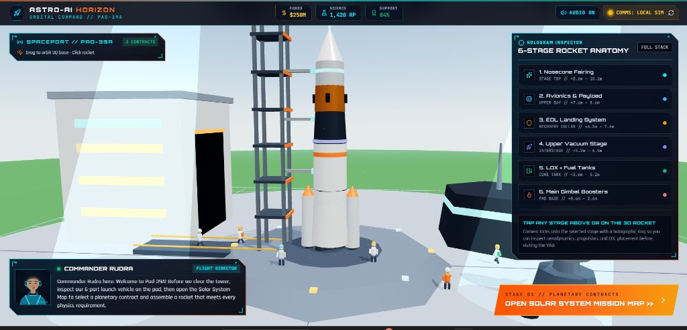
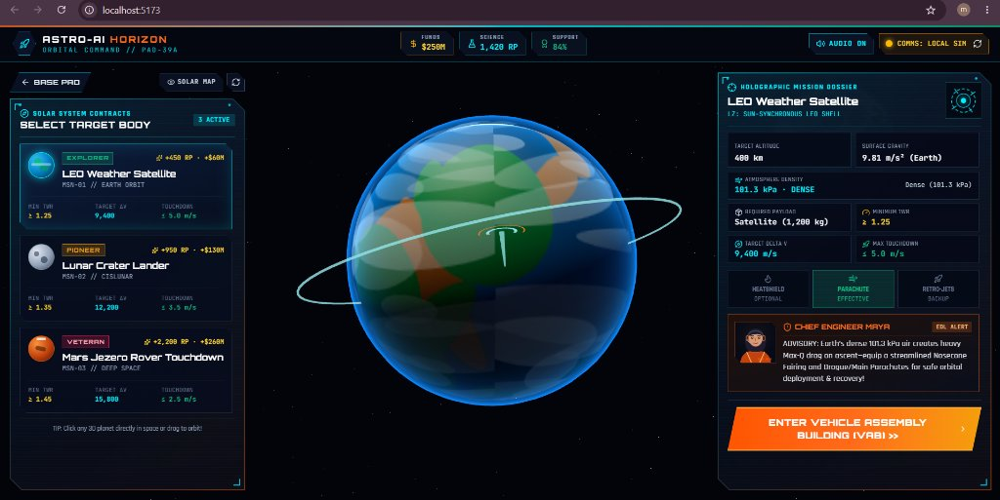
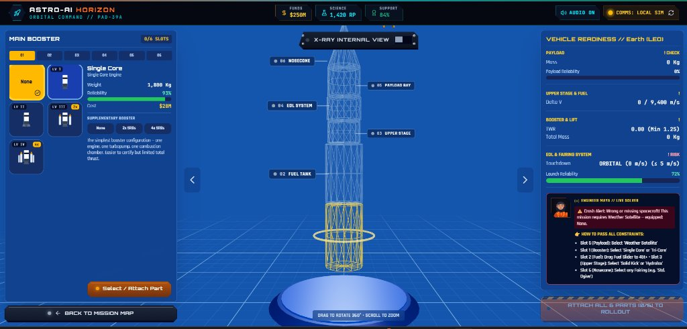
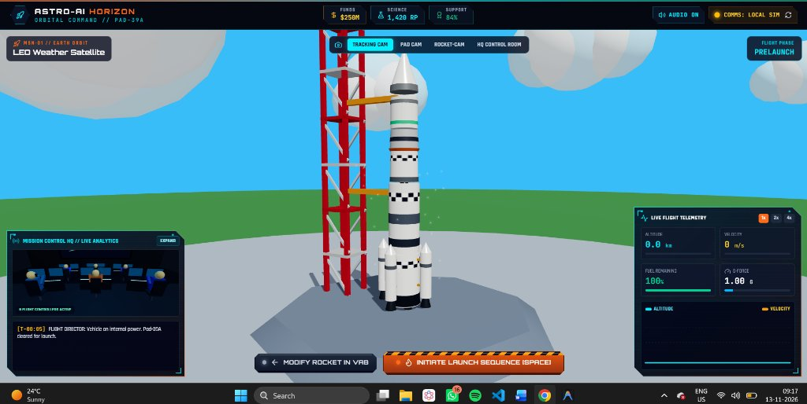
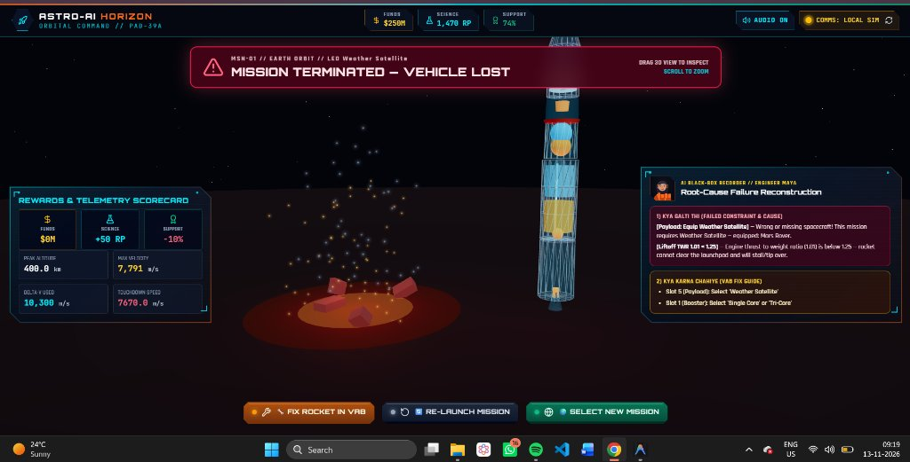
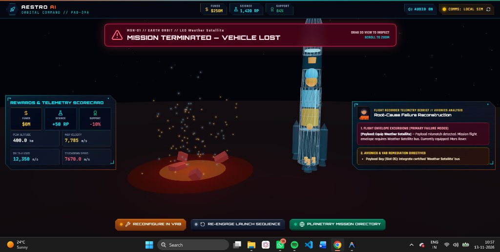
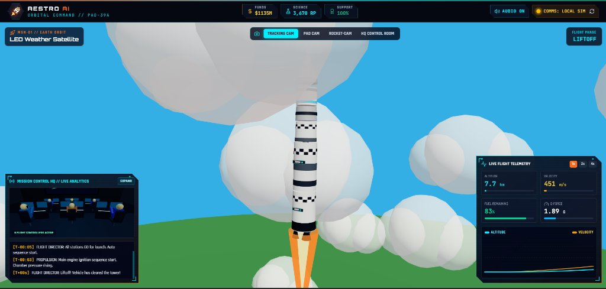
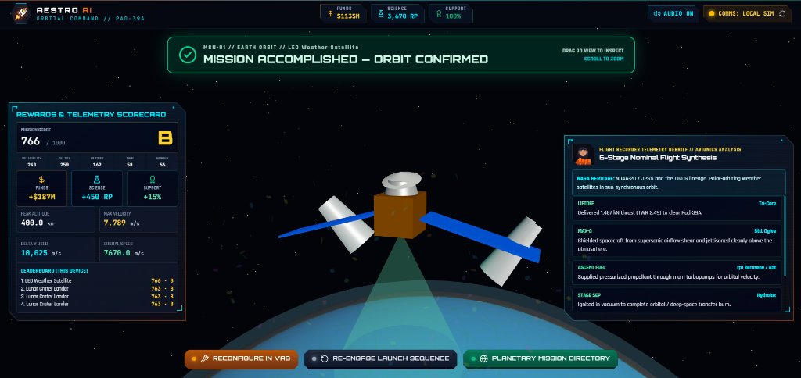
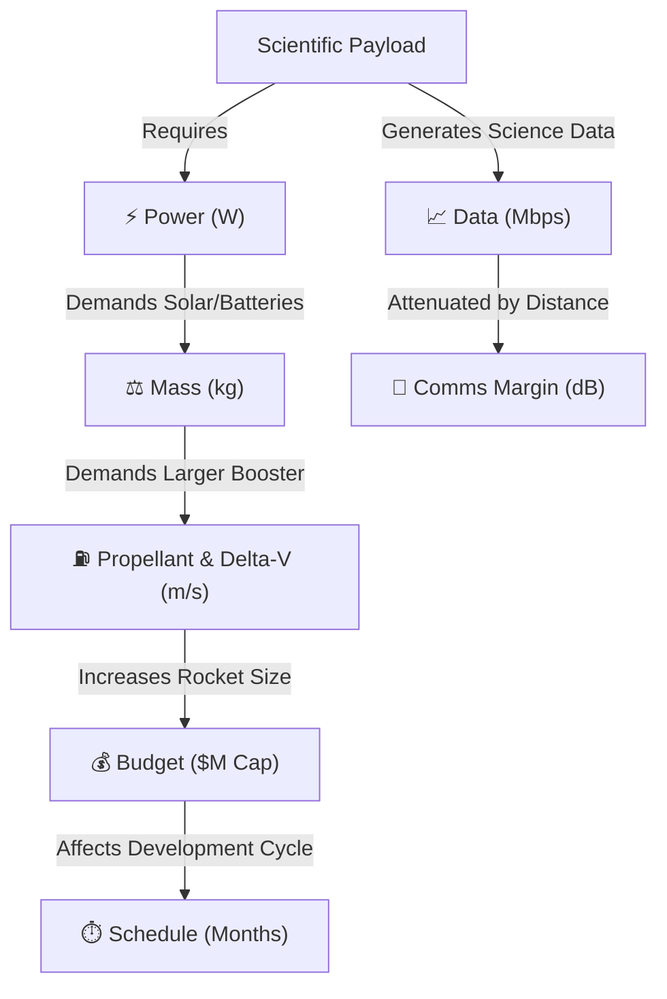

# 🚀 AESTRO AI // Space Mission Design Game

[](https://www.spaceappschallenge.org/2026/challenges/space-mission-design-game/)
[](https://astro-ai-engine.vercel.app/)
[](https://opensource.org/licenses/MIT)
[](https://github.com/MeetTailor-Data/astro-ai-engine)

> **Official Entry for the NASA Space Apps Challenge 2026 (Surat)**  
> **Challenge:** Space Mission Design Game  
> **Public Web Application:** [https://astro-ai-engine.vercel.app/](https://astro-ai-engine.vercel.app/)  
> **Repository:** [https://github.com/MeetTailor-Data/astro-ai-engine](https://github.com/MeetTailor-Data/astro-ai-engine)  

---

## 📖 Executive Summary

**AESTRO AI** is a browser-based aerospace systems-engineering simulation game designed for **1 to 4 players** (Solo or Multiplayer Team). It immerses players in NASA's rigorous space mission lifecycle across the **Four Mission Segments** (Launch, Space, Ground, and User Segments) and **Concept Maturity Levels (CML 1–4)**.

Rather than relying on simplified arcade mechanics, AESTRO AI challenges players to solve the fundamental systems-engineering dilemma: balancing **Mass, Power, Budget, Data, Telecommunications, and Schedule** against the laws of orbital mechanics (Tsiolkovsky rocket equation, Keplerian dynamics, and GMAT trajectory baselines). Players assemble modular multi-stage rockets in an interactive 3D Vehicle Assembly Building (VAB), conduct a multi-role **Flight Readiness Review (Team Go/No-Go Console)**, execute powered atmospheric ascents and EDL sequences in real time, and analyze flight anomalies through an automated debriefing engine matched with real NASA mission lineage.

---

## 📸 Visual Project Walkthrough & Gallery

The complete mission design lifecycle in AESTRO AI:

| 01. Mission Selection & Dossier | 02. 3D Vehicle Assembly Building (VAB) |
|:---:|:---:|
|  |  |
| *Browse mission contracts (LEO Sentinel, Lunar Lander, Mars Rover) with CML-1 requirements.* | *Modular 6-slot rocket configuration with interactive 360° WebGL 3D inspection.* |

| 03. Subsystem & Propellant Tuning | 04. 6-Resource Telemetry & Readiness |
|:---:|:---:|
|  |  |
| *Optimize engine cycles, propellants (Hydrolox, Methalox, RP-1), and fuel tank sizing.* | *Live budget caps, power margins, and Maya's Avionics Remediation Directives.* |

| 05. Launchpad Staging & Countdown | 06. In-Flight Ascent Telemetry |
|:---:|:---:|
|  |  |
| *Automated launch sequencer with cryogenic fueling and pad stabilization checks.* | *Live telemetry graphs: Altitude, velocity, dynamic pressure (Q), and G-force.* |

| 07. Mission Debrief & Scoring | 08. Multi-Camera Launch Tracking |
|:---:|:---:|
|  |  |
| *0–1000 objective scoring, letter grades (S–F), and local mission leaderboards.* | *Real-time exhaust particle physics, camera tracking, and pad telemetry.* |

| 09. Orbit Confirmed & NASA Heritage |
|:---:|
|  |
| *Orbit insertion confirmed with 3D deployed satellite and real NASA flight matching (NOAA-20 / JPSS).* |

---

## 🏛️ NASA Space Apps Challenge Alignment

AESTRO AI is built directly on the principles outlined in the **NASA Science Mission Directorate's *Design and Develop Science Missions (2025/2026)* guidelines**:

### 1. The Four Mission Segments
* 🚀 **Launch Segment:** Launch vehicle selection, booster clusters, multi-stage propellant mass fractions, liftoff Thrust-to-Weight Ratio ($\text{TWR} \ge 1.25$), and atmospheric drag.
* 🛰️ **Space Segment:** Spacecraft bus, science payloads (Earth observation, lunar surface lander, deep space rover), power generation (solar arrays/RTG), and thermal fairings.
* 📡 **Ground Segment:** Deep Space Network (DSN) link budget modeling, ground station contact windows, and frequency attenuation based on target body distance.
* 📊 **User Segment:** Downlink throughput ($\text{Mbps}$), science return point valuation, mission duration, and telemetry synthesis.

### 2. NASA Concept Maturity Level (CML) Progression
* **CML-1 (Feasibility Concept):** Objective definition, target delta-V baselines, and destination constraints.
* **CML-2 (Subsystem Trades):** Propellant chemistry trade-offs (Hydrolox $I_{sp} 450\text{s}$ vs. Methalox $380\text{s}$ vs. RP-1 $310\text{s}$), battery capacity, and antenna sizing.
* **CML-3 (System Integration):** Structural mass balance, aerodynamic fairing clearance, and power deficit mitigation.
* **CML-4 (Flight Readiness Review):** Multi-role Go/No-Go authorization and launchpad rollout clearance.

---

## ⚖️ The 6 Coupled Mission Resources

Spacecraft design requires navigating deeply coupled engineering feedback loops:



1. **Mass (kg):** Dry mass, propellant mass, liftoff mass, structural mass ratio, and liftoff TWR.
2. **Power (W):** Solar array / RTG wattage supply vs. avionics and payload demand with safety margins.
3. **Budget ($M):** Strict per-mission cost caps ($150M LEO, $340M Lunar, $640M Mars) with cost-efficiency score bonuses.
4. **Data (Mbps):** Raw instrument generation rate vs. storage buffer limits.
5. **Comms (dB):** Radio link margin modeled using Friis transmission equations over planetary distances.
6. **Time (Months):** Development schedule constraints evaluated against planetary launch windows.

---

## 🎮 Game Architecture & Key Features

### 1. Collaborative Team Go/No-Go Console (1–4 Players)
Before rollout to Pad-39A, teams conduct a live **Flight Readiness Review (FRR)**. Designed for solo players or cooperative teams of up to 4:
* **PROPULSION:** Clears TWR ($\ge 1.25$), Max-Q limits ($\le 5.0$), and target $\Delta V$ requirements.
* **SPACECRAFT:** Verifies payload bus matching, EDL system (heatshield/parachutes/retro-jets), and fairing protection.
* **POWER & COMMS:** Validates positive wattage margin ($\ge 0\%$) and telecommunications link margin ($\ge 0\text{ dB}$).
* **MISSION DIRECTOR:** Enforces project budget compliance and final launch authorization.
* *Interlock Feature:* The Mission Director cannot vote GO until all three disciplines are verified green. Any vehicle redesign automatically resets all approvals.

### 2. Chief Engineer Maya (Live Advisory System)
When configurations violate physical flight envelopes, Chief Engineer Maya provides live audio-visual advisories and **Avionics Remediation Directives** (e.g., advising propellant mass shifts, engine cycle changes, or fairing reinforcements).

### 3. Real-Time Flight & EDL Simulation
* Atmospheric ascent physics calculating dynamic pressure ($Q$), air density decay, and thrust curves.
* Staging events: Booster separation, stage ignition, fairing jettison above dense atmosphere, orbital insertion burn, and Entry, Descent & Landing (EDL) sequences.

### 4. NASA Mission Heritage Lineage Match
Successful flights are automatically benchmarked against real NASA exploration missions:
* **LEO Sun-Synchronous:** NOAA-20 / JPSS-1 Weather Sentinel Lineage.
* **Lunar Surface:** Surveyor 1 & Apollo Lunar Module Descent Lineage.
* **Mars Interplanetary:** Mars 2020 Perseverance & Curiosity Sky-Crane Lineage.

### 5. Responsive Hardware Advisory
AESTRO AI includes an automated client-side device advisory (`MobileBlocker.jsx`) that detects mobile devices and prompts users to open the game on a desktop workstation or toggle desktop landscape mode for optimal 3D WebGL performance.

---

## 🛠️ Technology Stack

| Layer | Technologies |
|---|---|
| **Frontend Framework** | React 18 / 19, Vite |
| **3D Graphics & WebGL** | Three.js, @react-three/fiber, @react-three/drei |
| **Styling & UI** | Tailwind CSS, Lucide Icons, Custom Sci-Fi Tactile HUD |
| **Simulation Physics** | TypeScript, Tsiolkovsky Multi-Stage Integrator |
| **Audio Engine** | Custom Web Audio API Synthesizer (Zero External Audio Dependencies) |
| **Deployment** | Vercel (Global Edge Network) |

---

## 🔬 NASA Data & AI Usage Disclosure

### NASA Data & Resources
1. **NASA General Mission Analysis Tool (GMAT):** Trajectory delta-V baselines ($9,400\text{ m/s}$ LEO, $13,200\text{ m/s}$ Moon, $16,800\text{ m/s}$ Mars).
2. **NASA Systems Engineering Handbook (SP-2016-6105 Rev 2):** Systems engineering lifecycle and trade-off matrices.
3. **NASA Jet Propulsion Laboratory (JPL) DSN Handbook:** Deep space communications link budget formulas and frequency bands.
4. **NASA Technical Reports Server (NTRS):** Mars 2020 Entry, Descent, and Landing (EDL) flight envelope specifications.

### AI & Automated Algorithms
* **Deterministic Optimization Engine:** AESTRO AI utilizes an automated constraint-satisfaction solver and real-time state vector evaluation routines rather than black-box machine learning, adhering to NASA's mission-critical requirement that spaceflight trajectories and life-support margins follow verifiable physical laws.

---

## 🚀 Local Development & Quick Start

### Prerequisites
* **Node.js:** v18.0.0 or higher
* **npm:** v9.0.0 or higher

### Installation

```bash
# 1. Clone the repository
git clone https://github.com/MeetTailor-Data/astro-ai-engine.git
cd astro-ai-engine/frontend

# 2. Install dependencies
npm install

# 3. Start local development server
npm run dev
```

Visit `http://localhost:5173/` in your browser.

---

## 👥 Official Team Roster & Roles

Developed with passion for the **NASA Space Apps Challenge 2026 (Surat)**:

| Member | NASA Space Apps Handle | Role in Project |
|---|---|---|
| **Meet Tailor** | `@meettailor` | **Team Leader** • Lead Systems Architect & NASA Data Resources Architecture |
| **Nirav Panwala** | `@nirav_panwala` | **Team Owner** • Simulation Engineering & Systems Integration |
| **Rudra Soni** | `@rudra_soni` | Flight Dynamics & Frontend Engineering, Physics Simulation |
| **Prajapati Dev Rameshbhai** | `@dev281206` | Project Management, Documentation & Presentation |
| **Tanay Sunil Puranik** | `@spaceking` | UI/UX Design & Mission Operations Interface |
| **Mansi Solanki** | `@mansisolanki` | Aerospace Research & Mission Profiles |

---

## 📜 References

1. NASA Science Mission Directorate, *Design and Develop Science Missions — Systems Engineering Overview*, 2025/2026.
2. NASA Goddard Space Flight Center, *General Mission Analysis Tool (GMAT) Mathematical Specification*, NASA Open Source Software GSC-19468-1.
3. NASA Jet Propulsion Laboratory, *Deep Space Network (DSN) Telecommunications Link Design Handbook*, 810-005.
4. NASA SP-2016-6105 Rev 2, *NASA Systems Engineering Handbook*, National Aeronautics and Space Administration.

---

## ⚖️ Copyright & Disclaimers

### Intellectual Property & License
* **Copyright © 2026 Meet Tailor & Team (AESTRO AI).** All rights reserved.
* Distributed as an open-source educational platform under the terms of the [**MIT License**](LICENSE).

### NASA Open Data & Non-Endorsement Disclaimer
* This project was independently developed for the **NASA Space Apps Challenge 2026 (Surat)** under the challenge *Space Mission Design Game*.
* **NASA Non-Endorsement Notice:** NASA does not endorse any non-U.S. Government entity and is not responsible for information contained on non-U.S. Government websites. All NASA data, mission profiles, and technical frameworks referenced are utilized in accordance with NASA Open Data policies and educational research guidelines.
* **Simulation Scope:** AESTRO AI is engineered strictly for educational simulation, science communication, and aerospace systems training. While trajectory values and orbital mechanics are grounded in NASA GMAT baselines, physical models are game-scaled for real-time interactive browser performance and are not intended for real-world spaceflight operations.
